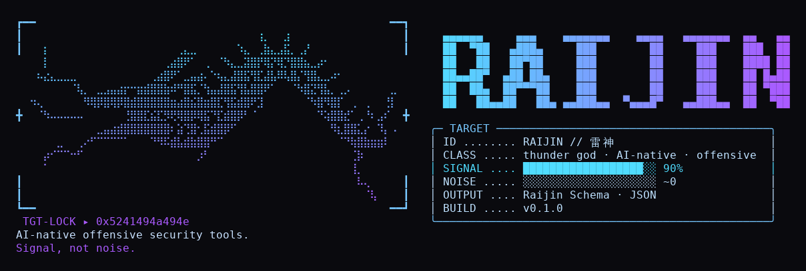
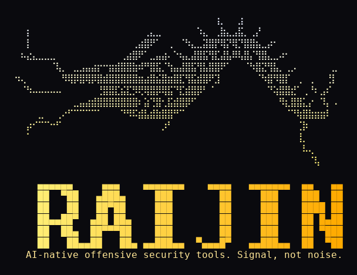
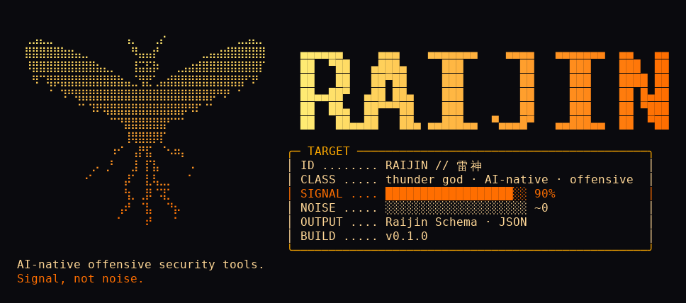
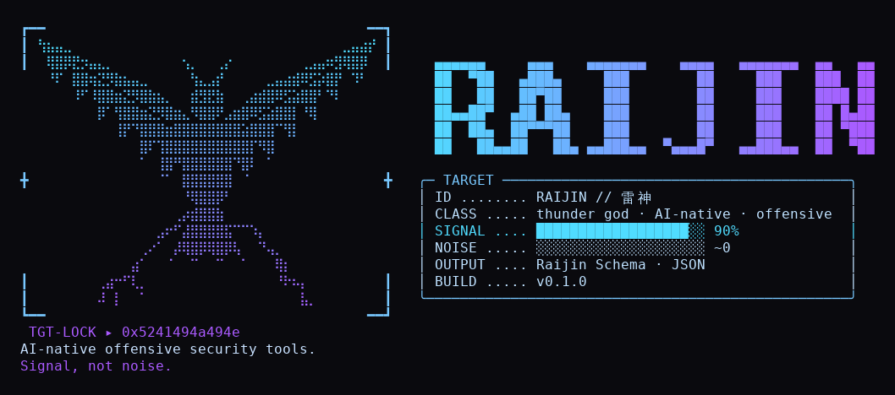
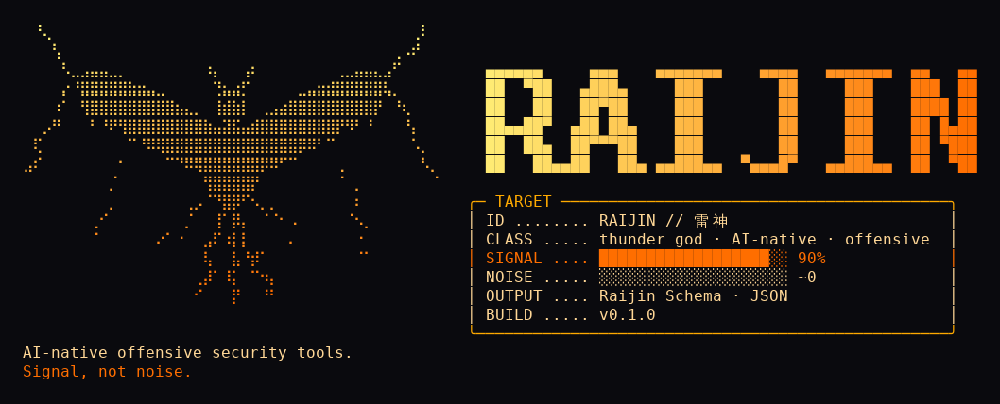
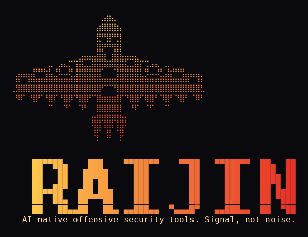
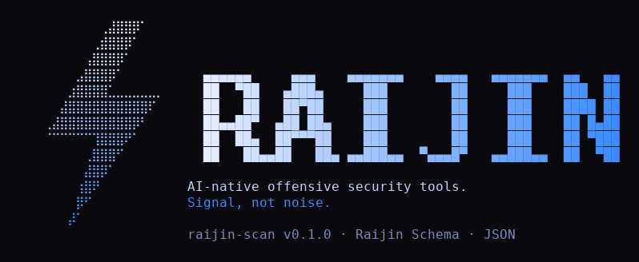
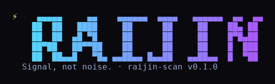

# Banner options

**Chosen: 3D**, the storm thunderbird (3B shape) in the 3A palette and frame. Implemented in [raijin-scan](https://github.com/protonnegativo/raijin-scan) as `--banner`.

The banner is **off by default**. It only prints with an explicit flag (`--banner`), so normal output stays a small JSON. The version number is filled in at runtime from the tool's version constant, so it never needs a manual update.

All art here is original: the dragon, the thunderbird and the bolt are drawn procedurally (`dragon.py`), then converted to braille (2×4 dots per character). `gen.py` renders these previews; the `.txt` files are what the terminal shows.

## 1. Lightning dragon · target-lock HUD (cyan → violet)

## 2. Lightning dragon · Kirin style (white → yellow), no HUD

## 3. Thunderbird · HUD (amber → orange)

### Thunderbird variations

#### 3A. Wings raised · target-lock HUD (cyan → violet)

#### 3B. Storm: bolts from the wingtips · HUD (amber → orange)

#### 3C. Totem: Northwest-coast geometric style, eyes on the wings (gold → red)

## 4. Bolt · compact (white → blue)

## 5. Minimal (least output)

